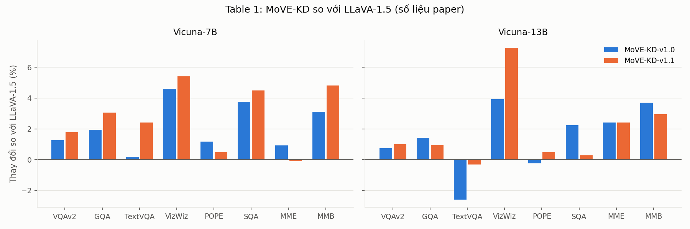
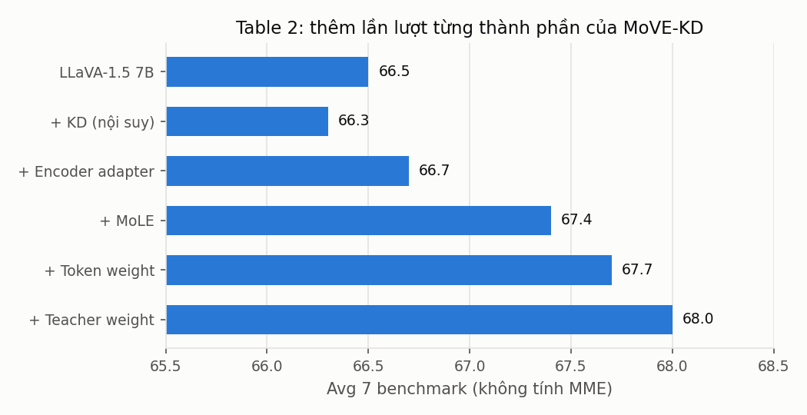
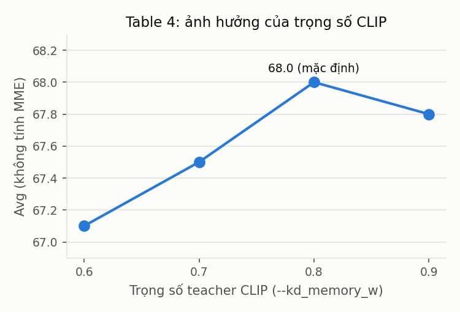

# MoVE-KD: Related Work & Experiments

> **Phạm vi tài liệu** (Thành viên 3 – Thực nghiệm, Benchmark & Code Execution)
> 1. **Related Work**: VLM, VLM nhiều encoder, Knowledge Distillation, MoE/LoRA (Sec 2 của paper).
> 2. **Experiments & Results**: thiết lập thực nghiệm, kết quả chính (Table 1), ablation (Table 2–5), kết quả tự chạy lại và trực quan hoá (Sec 4).
>
> Số liệu Table 1–5 chép nguyên từ paper ([arXiv:2501.01709](https://arxiv.org/abs/2501.01709), CVPR 2025). Hyper-parameter được đối chiếu với `scripts/move-kd/*.sh`. Kết quả tự chạy (mục 2.5) được sinh bằng các script trong [`scripts/move-kd/`](scripts/move-kd/), xem [mục 2.7](#27-cách-tái-lập).

---

## 1. Related Work

### 1.1 Vision-Language Models

**Kiến trúc encoder → connector → LLM.** Từ khi LLM đạt năng lực tổng quát mạnh, hướng phổ biến để xây VLM là "gắn mắt" cho LLM: một vision encoder đã tiền huấn luyện (thường là CLIP, vốn đã căn chỉnh với ngôn ngữ) trích đặc trưng ảnh, một khối kết nối đưa đặc trưng đó vào không gian embedding của LLM, sau đó cả hệ được huấn luyện trên dữ liệu ảnh–văn bản. Các mô hình khác nhau chủ yếu ở khối kết nối:

| Mô hình | Cách nối ảnh vào LLM |
| :--- | :--- |
| Flamingo | Chèn các lớp *gated cross-attention* vào giữa LLM đóng băng |
| BLIP-2 / InstructBLIP | *Q-Former*: một tập query học được nén đặc trưng ảnh thành số ít token (InstructBLIP cho query nhìn thêm câu lệnh) |
| Qwen-VL | Adapter cross-attention một lớp nén đặc trưng ViT về số token cố định |
| **LLaVA / LLaVA-1.5** | Chiếu thẳng *mọi* patch token bằng MLP (LLaVA-1.5: MLP 2 lớp, `mlp2x_gelu`) rồi huấn luyện 2 giai đoạn: pre-train projector trên LCS-558K, sau đó instruction-tune trên mix665k |
| LLaVA-NeXT | Giữ kiến trúc LLaVA, thêm *AnyRes*: cắt ảnh độ phân giải cao thành nhiều ô, mã hoá từng ô rồi nối chuỗi token |

MoVE-KD được xây trên LLaVA-1.5 (và thử thêm trên LLaVA-NeXT). Do đó mọi so sánh trong paper đều lấy chính LLaVA làm baseline, với cùng dữ liệu và cùng quy trình huấn luyện.

**Tăng cường vision encoder.** Vì chất lượng encoder giới hạn năng lực của cả VLM, nhiều nghiên cứu tìm cách làm phần "nhìn" mạnh hơn:

- *Tăng độ phân giải / số nhánh:* S² chạy cùng một encoder ở nhiều tỉ lệ ảnh. LLaVA-NeXT và LLaVA-HD cắt ảnh thành nhiều ô.
- *Ghép nhiều encoder (mixture of encoders):* Mini-Gemini thêm một encoder độ phân giải cao (ConvNeXt) để "khai thác" chi tiết cho token của CLIP. SPHINX trộn embedding của nhiều encoder. **Eagle** khảo sát có hệ thống việc kết hợp CLIP, ConvNeXt, EVA-02, Pix2Struct, SAM, … và cho thấy chỉ cần nối kênh đơn giản đã hiệu quả. **Cambrian-1** dùng *Spatial Vision Aggregator* để gộp nhiều encoder. MoVE-KD chọn bộ teacher (EVA-02, ConvNeXt) theo đúng kết quả của Eagle, và phần lớn code teacher trong repo (`multimodal_encoder/vision_models/`) cũng được mượn từ Eagle.

**Hạn chế mà MoVE-KD nhắm tới.** Các hướng trên đều *tăng chi phí suy luận*: ảnh lớn hơn, nhiều token hơn, hoặc phải chạy nhiều encoder cho mỗi ảnh. MoVE-KD đi theo hướng ngược lại. Nhiều encoder chỉ tham gia lúc huấn luyện (làm teacher); lúc suy luận vẫn chỉ có **một** CLIP ViT-L/14-336 cùng một lượng nhỏ tham số LoRA, nên số token và độ phân giải giữ nguyên như LLaVA-1.5.

### 1.2 Knowledge Distillation

**KD kinh điển.** Hinton et al. (2015) đề xuất cho student học phân phối mềm (soft label, có nhiệt độ) của teacher, tức là học "dark knowledge" thay vì chỉ học nhãn cứng. FitNets mở rộng sang *feature distillation*: ép đặc trưng trung gian của student khớp với teacher thông qua một lớp chiếu. MoVE-KD thuộc nhánh feature distillation, với hàm loss là MSE giữa token của student và token của teacher đã đi qua adapter.

**KD cho vision encoder.** DINOv2 dùng self-distillation để tạo các bản nhỏ từ một ViT lớn. Wei et al. (Feature Distillation) chưng cất từ một teacher CLIP. Cả hai đều chỉ có **một** teacher, nên student bị giới hạn bởi năng lực của teacher đó. **AM-RADIO** là công trình gần nhất: chưng cất đồng thời CLIP, DINOv2 và SAM vào một ViT trên DataComp-1B (khoảng 1,4 tỉ cặp ảnh–văn bản), rồi thay encoder đó vào LLaVA. Các hướng đa teacher khác như Theia (cho robot) và UNIC (cho phân loại) cũng chưng cất *độc lập*, bên ngoài VLM. Điểm khác của MoVE-KD là **chưng cất ngay trong khung VLM**: loss KD được cộng thẳng vào loss sinh văn bản và dùng chính dữ liệu huấn luyện của LLaVA, không cần thêm dữ liệu nào.

**KD với nhiều teacher.** You et al. (2017) huấn luyện student dưới giám sát của nhiều teacher. OneS ("One Student Knows All Experts Know") gom tri thức từ nhiều expert vào một mô hình dày đặc. LLaVA-MoD dùng chưng cất kiểu MoE để thu nhỏ LLaVA, nhưng chưng cất ở phía LLM. Theo các tác giả, MoVE-KD là công trình đầu tiên chưng cất **nhiều vision encoder** để cải thiện VLM.

**Trọng số cho token/teacher.** Ý tưởng "không phải token nào cũng đáng chưng cất như nhau" đã xuất hiện ở *Masked distillation with receptive tokens* (cùng nhóm tác giả). Ngoài ra, "Vision Transformers Need Registers" phát hiện các token "artifact" có attention cao ở vùng nền. MoVE-KD dùng [CLS] attention của CLIP làm trọng số token, và **cố ý giữ** các artifact token vì cho rằng chúng mang thông tin toàn cục (Sec 5.2, thuộc phần của TV2).

### 1.3 Mixture-of-Experts và LoRA

MoE (Jacobs et al., 1991; Switch Transformer) dùng router để chỉ kích hoạt một phần expert cho mỗi token. Cách này tăng dung lượng mô hình mà không tăng chi phí tính toán tương ứng. Trong VLM, MoE-LLaVA và Uni-MoE đưa MoE vào **LLM**. LoRA (Hu et al., 2022) học phần bù hạng thấp `ΔW = BA` thay vì cập nhật toàn bộ `W`. Kết hợp hai ý tưởng này cho ra *mixture of LoRA experts* (LoRAMoE, MoLE, …), thường dùng cho fine-tune đa tác vụ hoặc để giảm quên tri thức. MoVE-KD áp dụng MoLE vào **vision encoder** với mục đích khác: để các expert LoRA "chia việc" khi student phải học đồng thời từ nhiều teacher có không gian đặc trưng mâu thuẫn nhau. Chi tiết kiến trúc nằm ở mục 2.3 trong `Introduction.md`.

### 1.4 Vị trí của MoVE-KD

| | Encoder lúc suy luận | Thêm dữ liệu? | Chưng cất trong VLM? |
| :--- | :--- | :--- | :--- |
| Eagle / Cambrian-1 / Mini-Gemini | Nhiều encoder | Tuỳ | Không (ghép trực tiếp) |
| AM-RADIO | 1 encoder | Có (DataComp-1B) | Không (chưng cất trước, thay vào sau) |
| **MoVE-KD** | **1 CLIP + MoLE** | **Không** | **Có** (KD loss cộng vào loss sinh văn bản) |

---

## 2. Experiments & Results

### 2.1 Thiết lập thực nghiệm

**Mô hình.** Khung chính là LLaVA-1.5 với LLM Vicuna-7B/13B. Paper thử thêm LLaVA-1.5 với MobileLLaMA-1.4B ("1.7B") và LLaVA-NeXT 7B/13B. Student là CLIP ViT-L/14-336 (`openai/clip-vit-large-patch14-336`), được thay các FFN bằng MoLE gồm 3 expert, rank 32.

**Teacher.** Paper có hai phiên bản:

| Phiên bản | Teacher | Cờ trong script |
| :--- | :--- | :--- |
| MoVE-KD-v1.0 | CLIP, EVA-02-L, ConvNeXt-XXL | `--encoder_teachers clip eva convnext` |
| MoVE-KD-v1.1 | v1.0 + **SAM-L** | `--encoder_teachers clip sam eva convnext` |

Ngoài teacher, hai phiên bản dùng cấu hình giống hệt nhau (`diff pretrain-v1.0.sh pretrain-v1.1.sh` chỉ khác ở dòng này và ở `--output_dir`). Vì vậy so sánh v1.0 với v1.1 chính là **ablation "thêm teacher SAM"**.

**Dữ liệu.** Pre-train dùng LLaVA LCS-558K (`blip_laion_cc_sbu_558k.json`). Fine-tune dùng mix665k của LLaVA-1.5, hoặc dữ liệu của LLaVA-NeXT với các mô hình NeXT. Paper **không thêm dữ liệu** nào ngoài dữ liệu của baseline.

**Huấn luyện 2 giai đoạn** (cả hai giai đoạn đều tối ưu `L_total = L_text + λ_kd · L_kd`):

| | Stage 1 – Pre-train | Stage 2 – Fine-tune |
| :--- | :--- | :--- |
| Tham số được học | MoLE, encoder adapters, projector | Toàn bộ, trừ teacher |
| Cờ chính | `--tune_mm_mlp_adapter --tune_encoder --tune_encoder_adapter` | `--finetune --tune_all` + nạp `mm_projector.bin`, `mole_encoder.bin`, `encoder_adapter.bin` |
| Learning rate | 1e-3 | 2e-5 |
| Batch / GPU | 16 | 8 |
| Epoch | 1 | 1 |

**Hyper-parameter của MoVE-KD** (đối chiếu paper ↔ code):

| Ý nghĩa | Paper | Cờ trong `scripts/move-kd/*.sh` |
| :--- | :--- | :--- |
| Trọng số loss KD `λ_kd` | 0.5 | `--kd_w 0.5` |
| Trọng số teacher CLIP | 0.8 | `--kd_memory_w 0.8` |
| Số expert / rank LoRA | 3 / 32 | `--moe_encoder_num_experts 3 --moe_encoder_lora_rank 32` |
| Trọng số loss cân bằng router | (không nêu) | `--moe_encoder_balance_w 0.01` |
| Token weight / Teacher weight | bật | `--token_weight True --teacher_weight True` |

Paper huấn luyện trên **16×A800**. Các thông số còn lại giữ như LLaVA (bf16, ZeRO-2, cosine schedule, warmup 3%, max length 2048).

**8 benchmark.**

| Benchmark | Đánh giá năng lực | Split / quy mô | Metric | Chấm điểm |
| :--- | :--- | :--- | :--- | :--- |
| VQAv2 | VQA tổng quát | test-dev, ~107K câu | VQA accuracy | Server EvalAI |
| GQA | Suy luận cấu trúc, quan hệ không gian | testdev-balanced, ~12,6K câu | Accuracy | Local |
| TextVQA | Đọc chữ trong ảnh (OCR) | val, 5.000 câu | VQA accuracy | Local |
| VizWiz | Ảnh do người khiếm thị chụp, có câu không trả lời được | test, 8.000 câu | VQA accuracy | Server EvalAI |
| POPE | Ảo giác đối tượng (hỏi yes/no "có X trong ảnh không?") | 3 split random/popular/adversarial trên COCO val2014 | F1 trung bình 3 split | Local |
| SQA | ScienceQA, câu trắc nghiệm có ảnh | test-IMG, 2.017 câu | Accuracy | Local |
| MME | Perception (10 tác vụ con) | 2.374 câu yes/no (cả perception và cognition) | Tổng điểm perception (tối đa 2000) | Local |
| MMB | MMBench, trắc nghiệm đa năng lực | dev | Accuracy (CircularEval) | Server |

Hai benchmark VQAv2 và VizWiz phải nộp lên server, còn MMB vừa nộp server vừa có quy mô lớn. Vì vậy phần tự chạy lại (mục 2.5) chỉ làm 4 benchmark chấm được ngay tại máy: **POPE, MME, TextVQA, SQA**.

### 2.2 Kết quả chính (Table 1)

Bảng dưới là các dòng LLaVA-1.5 của Table 1 trong paper. Số in đậm là tốt nhất trong từng khối.

| Phương pháp | LLM | VQAv2 | GQA | TextVQA | VizWiz | POPE | SQA | MME | MMB |
| :--- | :--- | ---: | ---: | ---: | ---: | ---: | ---: | ---: | ---: |
| LLaVA-1.5 | MobileLLaMA-1.4B | 71.5 | 55.4 | 42.6 | 28.6 | 84.3 | 56.0 | 1145.7 | 47.0 |
| + MoVE-KD-v1.0 | MobileLLaMA-1.4B | 72.9 | 56.6 | 43.4 | **32.1** | 84.8 | 56.1 | 1182.3 | 47.4 |
| + MoVE-KD-v1.1 | MobileLLaMA-1.4B | **73.8** | **57.7** | **44.3** | 29.3 | **86.1** | **57.3** | **1188.4** | **48.8** |
| LLaVA-1.5 | Vicuna-7B | 78.5 | 62.0 | 58.2 | 50.0 | 85.9 | 66.8 | 1510.7 | 64.3 |
| + RADIO | Vicuna-7B | 76.3 | 63.0 | 56.3 | – | 86.2 | – | – | – |
| + MoVE-KD-v1.0 | Vicuna-7B | 79.5 | 63.2 | 58.3 | 52.3 | **86.9** | 69.3 | **1524.5** | 66.3 |
| + MoVE-KD-v1.1 | Vicuna-7B | **79.9** | **63.9** | **59.6** | **52.7** | 86.3 | **69.8** | 1509.1 | **67.4** |
| LLaVA-1.5 | Vicuna-13B | 80.0 | 63.3 | **61.3** | 53.6 | 85.9 | 71.6 | 1531.3 | 67.7 |
| + MoVE-KD-v1.0 | Vicuna-13B | 80.6 | **64.2** | 59.7 | 55.7 | 85.7 | **73.2** | 1568.1 | **70.2** |
| + MoVE-KD-v1.1 | Vicuna-13B | **80.8** | 63.9 | 61.1 | **57.5** | **86.3** | 71.8 | **1568.3** | 69.7 |

Kết quả với LLaVA-NeXT (cũng trong Table 1):

| Phương pháp | LLM | VQAv2 | GQA | TextVQA | VizWiz | POPE | SQA | MME | MMB |
| :--- | :--- | ---: | ---: | ---: | ---: | ---: | ---: | ---: | ---: |
| LLaVA-NeXT | Vicuna-7B | 81.8 | 64.2 | **64.9** | 57.6 | 86.5 | 70.1 | 1519.0 | 67.4 |
| + MoVE-KD-v1.0 | Vicuna-7B | **82.3** | **64.5** | 63.7 | **58.0** | **86.7** | **70.7** | **1537.2** | **67.6** |
| LLaVA-NeXT | Vicuna-13B | 82.8 | 65.4 | **67.1** | 60.5 | 86.2 | 73.6 | 1575.0 | 70.0 |
| + MoVE-KD-v1.0 | Vicuna-13B | **83.1** | **65.7** | 65.8 | **60.9** | **86.8** | **73.7** | **1579.3** | **70.6** |



*Hình 1. Mức thay đổi tương đối (%) của MoVE-KD so với LLaVA-1.5 trên từng benchmark. Dùng % để MME (thang khoảng 1500) và các benchmark thang 100 nằm chung một trục. Sinh bằng `scripts/move-kd/summarize_results.py`.*

**Nhận xét.**

1. **Cải thiện ổn định ở 7B.** MoVE-KD-v1.1 tăng trên 7/8 benchmark so với LLaVA-1.5-7B: VQAv2 +1.4, GQA +1.9, TextVQA +1.4, VizWiz +2.7, POPE +0.4, SQA +3.0, MMB +3.1. Riêng MME giảm nhẹ (−1.6 điểm). Mức tăng lớn nhất nằm ở **VizWiz, SQA và MMB**, những bộ cần hiểu ảnh "khó" (ảnh mờ hoặc lệch, sơ đồ khoa học, câu hỏi đa năng lực).
2. **7B chưng cất tiệm cận, thậm chí vượt 13B gốc.** MoVE-KD-v1.1-7B vượt LLaVA-1.5-13B ở GQA (63.9 so với 63.3) và POPE (86.3 so với 85.9), trong khi phần lớn chênh lệch còn lại dưới 1 điểm.
3. **So với RADIO.** RADIO thay CLIP bằng một encoder được chưng cất trên 1,4 tỉ cặp ảnh–văn bản, nhưng **giảm** ở VQAv2 (−2.2) và TextVQA (−1.9) so với LLaVA-1.5. Paper giải thích đây là hiện tượng quên tri thức căn chỉnh ngôn ngữ của CLIP. MoVE-KD không thêm dữ liệu mà vẫn không giảm ở hai bộ này, nhờ giữ CLIP làm teacher "neo" (trọng số 0.8) và giữ nguyên trọng số gốc của FFN.
4. **TextVQA là điểm yếu nhất quán.** Ở 13B (v1.0: −1.6) và LLaVA-NeXT (7B: −1.2, 13B: −1.3), TextVQA giảm. Paper cho rằng nhiều câu TextVQA phụ thuộc vào OCR token có sẵn trong prompt hơn là vào đặc trưng thị giác, nên tăng cường encoder có thể phản tác dụng. Một giải thích khác có thể bổ sung là các teacher được chọn (EVA-02 phát hiện đối tượng, ConvNeXt CLIP, SAM phân đoạn) không có teacher nào chuyên về văn bản. Repo có hỗ trợ Pix2Struct (teacher cho tài liệu, OCR) nhưng không dùng nó ở v1.0/v1.1.
5. **Áp dụng được cho nhiều kích thước LLM và kiến trúc.** Phương pháp cải thiện được cả LLM 1.4B lẫn LLaVA-NeXT (vốn đã dùng AnyRes độ phân giải cao). Như vậy lợi ích của MoVE-KD không trùng hoàn toàn với lợi ích của việc tăng độ phân giải.

### 2.3 Ablation study

#### Table 2 – Thêm lần lượt từng thành phần (LLaVA-1.5-7B, teacher v1.0)

| Phương pháp | VQAv2 | GQA | TextVQA | VizWiz | POPE | SQA | MME | MMB | Avg |
| :--- | ---: | ---: | ---: | ---: | ---: | ---: | ---: | ---: | ---: |
| LLaVA-1.5 7B | 78.5 | 62.0 | 58.2 | 50.0 | 85.9 | 66.8 | 1510.7 | 64.3 | 66.5 |
| + KD (nội suy) | 79.0 | 62.4 | 56.7 | 50.9 | 84.7 | 67.6 | 1507.6 | 62.9 | 66.3 |
| + Encoder adapter | 79.3 | 62.4 | 57.0 | 51.2 | 85.2 | 68.3 | 1517.8 | 63.8 | 66.7 |
| + MoLE | 79.1 | 62.8 | 57.3 | 51.9 | 86.4 | 68.7 | 1521.3 | 65.4 | 67.4 |
| + Token weight | 79.3 | 63.1 | 57.7 | 52.5 | 86.7 | 68.9 | 1524.1 | 66.0 | 67.7 |
| + Teacher weight | 79.5 | 63.2 | 58.3 | 52.3 | 86.9 | 69.3 | 1524.5 | 66.3 | **68.0** |

> Cột **Avg** của paper là trung bình 7 benchmark, **không tính MME**. Ví dụ dòng đầu: (78.5 + 62.0 + 58.2 + 50.0 + 85.9 + 66.8 + 64.3) / 7 = 66.5.



*Hình 2. Avg sau khi lần lượt thêm từng thành phần (Table 2).*

- **KD "ngây thơ" (nội suy) còn tệ hơn không chưng cất** (Avg 66.5 → 66.3). Cách này nội suy token teacher về lưới 24×24 rồi hồi quy trực tiếp. TextVQA (−1.5), POPE (−1.2) và MMB (−1.4) đều giảm. Đây là bằng chứng cho vấn đề *bất đồng không gian đặc trưng*: ép trực tiếp có thể làm mất thông tin và làm hỏng biểu diễn của CLIP.
- **Encoder adapter** (+0.4 Avg) thay phép nội suy bằng phép chiếu học được (`Linear` theo kênh rồi `Linear` theo token, xem `initialize_teachers`). Nhờ vậy KD bắt đầu có lợi.
- **MoLE đóng góp nhiều nhất** (+0.7 Avg), với POPE +1.2 và MMB +1.6. Paper giải thích rằng việc kích hoạt expert theo đầu vào giảm *xung đột tri thức* giữa các teacher.
- **Token weight** (+0.3) và **teacher weight** (+0.3) là hai thành phần chính quy hoá dựa trên [CLS] attention (TV2 phân tích chi tiết). Mỗi thành phần tăng thêm một chút và tăng khá đều trên các benchmark.
- **Tổng cộng: +1.5 Avg** so với LLaVA-1.5. Trong đó gần một nửa đến từ MoLE.

#### Table 3 – MoLE *không* KD: lợi ích có đến từ việc thêm tham số không?

| MoLE | VQAv2 | GQA | TextVQA | VizWiz | POPE | SQA | MMB | Avg |
| :--- | ---: | ---: | ---: | ---: | ---: | ---: | ---: | ---: |
| w/o | 76.7 | 60.0 | 54.8 | 51.9 | 81.5 | 64.1 | 62.1 | 64.4 |
| w/ | 77.4 | 60.3 | 55.6 | 51.3 | 82.1 | 63.7 | 61.5 | 64.5 |

MoLE chỉ thêm khoảng 0,3% tham số. Khi bỏ KD, thêm MoLE gần như không thay đổi kết quả (Avg 64.4 → 64.5, SQA và MMB còn giảm). Vì vậy mức tăng ở Table 2 **không** đến từ việc có thêm tham số, mà từ việc MoLE giúp *hấp thụ tri thức của teacher*. Lưu ý: dòng "w/o" trùng số với dòng "Unfreeze" ở Table 5, tức là cả hai thí nghiệm trong bảng này đều mở băng encoder. Paper còn ghi nhận rằng nếu mở băng encoder để chưng cất mà **không** dùng MoLE, quá trình huấn luyện thường bị hỏng (loss bất thường) và phải đặt learning rate riêng cho encoder.

#### Table 4 – Trọng số của teacher CLIP

| Trọng số CLIP | VQAv2 | GQA | TextVQA | VizWiz | POPE | SQA | MME | MMB | Avg |
| :--- | ---: | ---: | ---: | ---: | ---: | ---: | ---: | ---: | ---: |
| 0.6 | 78.8 | 62.6 | 57.3 | 51.7 | 86.6 | 68.2 | 1518.4 | 64.5 | 67.1 |
| 0.7 | 79.1 | 62.5 | 57.9 | 52.1 | 86.3 | 69.5 | 1521.7 | 65.2 | 67.5 |
| **0.8** | 79.5 | 63.2 | 58.3 | 52.3 | 86.9 | 69.3 | 1524.5 | 66.3 | **68.0** |
| 0.9 | 80.1 | 62.9 | 57.8 | 51.9 | 86.6 | 69.4 | 1519.5 | 65.8 | 67.8 |



*Hình 3. Avg theo trọng số teacher CLIP (`--kd_memory_w`).*

Student được khởi tạo từ CLIP, và projector cùng LLM đều "quen" với không gian đặc trưng của CLIP. Vì thế teacher CLIP cần trọng số lớn: giảm từ 0.8 xuống 0.6 làm mất 0.9 Avg. Tuy vậy, trọng số quá lớn (0.9) lại làm giảm phần tri thức học được từ các teacher khác. Giá trị 0.8 cân bằng giữa *giữ tri thức cũ* và *học tri thức mới*, và đây cũng là giá trị mặc định trong code (`kd_memory_w = 0.8`). Phần trọng số còn lại (0.2) được chia cho các teacher khác: chia đều, hoặc chia theo softmax của độ tương đồng với [CLS] khi bật `--teacher_weight`.

#### Table 5 – Đóng băng hay mở băng encoder?

| Encoder | VQAv2 | GQA | TextVQA | VizWiz | POPE | SQA |
| :--- | ---: | ---: | ---: | ---: | ---: | ---: |
| Unfreeze | 76.7 | 60.0 | 54.8 | 51.9 | 81.5 | 64.1 |
| Freeze (LLaVA-1.5 gốc) | 78.5 | 62.0 | 58.2 | 50.0 | 85.9 | 66.8 |

MoVE-KD bắt buộc phải cập nhật encoder (qua MoLE). Thí nghiệm này loại trừ khả năng "chỉ cần mở băng encoder là đã tốt hơn": mở băng encoder của LLaVA-1.5 (không KD) làm **giảm** 5/6 benchmark (POPE −4.4, TextVQA −3.4, SQA −2.7), chỉ VizWiz tăng. Như vậy mức tăng của MoVE-KD thực sự đến từ quá trình chưng cất.

#### Thêm teacher SAM (v1.0 → v1.1)

Theo paper, thêm SAM-L giúp mô hình "tốt hơn khi có nhiều teacher hơn". Khi đọc kỹ Table 1, kết quả thực tế **không đồng đều**:

| Δ (v1.1 − v1.0) | VQAv2 | GQA | TextVQA | VizWiz | POPE | SQA | MME | MMB |
| :--- | ---: | ---: | ---: | ---: | ---: | ---: | ---: | ---: |
| 1.7B | +0.9 | +1.1 | +0.9 | −2.8 | +1.3 | +1.2 | +6.1 | +1.4 |
| 7B | +0.4 | +0.7 | +1.3 | +0.4 | −0.6 | +0.5 | −15.4 | +1.1 |
| 13B | +0.2 | −0.3 | +1.4 | +1.8 | +0.6 | −1.4 | +0.2 | −0.5 |

Thay đổi nhất quán duy nhất là **TextVQA tăng ở cả 3 kích thước** (+0.9 đến +1.4). Điều này hợp lý vì SAM giỏi biên và chi tiết mức pixel, có ích cho việc đọc chữ. Các benchmark khác lên xuống tuỳ kích thước mô hình. Khi viết báo cáo nên trình bày khả năng mở rộng theo số teacher là một *xu hướng tích cực*, chưa phải kết luận chắc chắn.

### 2.4 Trực quan hoá [CLS] attention (Fig 5)

Paper (Fig 5, Sec 4.4) so sánh [CLS] attention của CLIP gốc và của student sau chưng cất. Student giảm chú ý vào vùng lặp lại (bầu trời, nền trống), tập trung hơn vào đối tượng và chữ (đám đông, băng rôn, dòng "Headline", máy bay, đường băng), trong khi vẫn giữ khả năng định vị vốn có của CLIP.

Repo gốc không có code vẽ hình này, nên mình viết [`scripts/move-kd/visualize_attention.py`](scripts/move-kd/visualize_attention.py) với các đặc điểm sau:

- Tính [CLS] attention **giống hệt cách tính token weight** trong `MoVELlavaLlamaForCausalLM.forward`: `attentions[-2].mean(heads)[:, 0, 1:]` → softmax → lưới 24×24.
- Chỉ nạp vision encoder: đọc shard `model-00003-of-00003.safetensors`, chứa cả 1015 tensor của vision tower, và dựng lại CLIP + MoLE theo `EvalMoVELlavaLlamaForCausalLM`. Script không cần nạp LLM 7B nên chạy được trên CPU.
- Vẽ thêm **bản đồ routing MoLE**: expert được chọn cho mỗi patch token ở một số layer, và tỉ lệ token vào từng expert theo layer. Hình này không có trong paper, nhưng giúp kiểm tra giả thuyết "mỗi expert chuyên một loại tri thức".

| Hình | Nội dung |
| :--- | :--- |
| `images/attn_<ảnh>.png` | Ảnh / [CLS] attention của CLIP gốc / của student MoVE-KD-v1.1 |
| `images/routing_<ảnh>.png` | Expert MoLE được chọn cho mỗi patch tại layer 0, 8, 16, 22 |
| `images/routing_share.png` | Tỉ lệ patch token đi vào mỗi expert theo layer |

> *Chèn hình và nhận xét sau khi chạy (Ngày 3).* Khi nhận xét, nên so sánh với các quan sát của paper (Sec 4.4): student có giảm attention ở vùng nền lặp lại không, và các token "artifact" có attention cao ở vùng nền còn không (Sec 5.2).

### 2.5 Kết quả tự chạy lại

**Mục tiêu.** Kiểm tra checkpoint MoVE-KD-v1.1-7B đã công bố ([`jiaojuncao/MoVE-KD-7b-v1.1`](https://huggingface.co/jiaojuncao/MoVE-KD-7b-v1.1)) có cho ra đúng số liệu trong paper trên 4 benchmark chấm local hay không.

**Môi trường.** *(điền: GPU, CUDA, thời gian chạy mỗi benchmark)*

| Benchmark | Paper (v1.1-7B) | Tự chạy | Chênh lệch |
| :--- | ---: | ---: | ---: |
| POPE (F1 trung bình) | 86.3 | *(chưa chạy)* | |
| MME (perception) | 1509.1 | *(chưa chạy)* | |
| TextVQA | 59.6 | *(chưa chạy)* | |
| SQA-IMG | 69.8 | *(chưa chạy)* | |

> Bảng và biểu đồ `images/results_reproduced_<tên>.png` được sinh tự động bằng lệnh `python scripts/move-kd/summarize_results.py --name llava-move-kd-7b-v1.1`. Chênh lệch dưới khoảng 1 điểm (MME dưới khoảng 15 điểm) có thể coi là tái lập thành công, vì có sai khác do phần cứng, phiên bản thư viện và fp16 khi suy luận.

**Smoke-test pipeline huấn luyện** (`scripts/move-kd/smoke_pretrain.sh`): chạy Stage 1 với 4 teacher, nhưng thay Vicuna-7B bằng TinyLlama-1.1B và chỉ chạy khoảng 30 bước. Mục tiêu là xác nhận forward KD, backward và việc lưu `mole_encoder.bin` / `encoder_adapter.bin` đều chạy được trên 1 GPU, **không** nhằm tái lập số liệu. *(điền: VRAM tối đa, loss đầu/cuối)*

### 2.6 Ghi chú tái lập (các vấn đề gặp khi chạy code)

1. **Tên checkpoint phải chứa `llava`.** `llava/model/builder.py` chỉ nạp nhánh multimodal (`EvalMoVELlavaLlamaForCausalLM` + image processor) khi tên thư mục cuối chứa `llava`. Tên này lấy qua `get_model_name_from_path`. Nếu truyền thẳng `jiaojuncao/MoVE-KD-7b-v1.1`, model được nạp như LLM thuần, `image_processor = None` và eval bị lỗi. `scripts/move-kd/eval/download_ckpt.sh` tải checkpoint về `checkpoints/llava-move-kd-7b-v1.1`, còn `common.sh` từ chối chạy nếu tên checkpoint không chứa `llava`.
2. **Script eval gốc hardcode model.** `scripts/v1_5/eval/*.sh` trỏ cố định tới `liuhaotian/llava-v1.5-13b`. Các wrapper trong `scripts/move-kd/eval/` nhận đường dẫn checkpoint làm tham số và hỗ trợ `LIMIT=N` để chạy thử trên tập con.
3. **Chấm trên tập con.** `eval_science_qa.py` coi câu chưa chạy là `FAILED`, nên `Accuracy` tổng bị kéo xuống khi dùng `LIMIT`. Tuy nhiên `IMG-Accuracy` (đúng metric của paper) vẫn đúng, vì câu chưa chạy không được tính là câu có ảnh. MME không hỗ trợ `LIMIT`, vì `convert_answer_to_mme.py` cần đủ câu trả lời.
4. **Thư viện.** `pyproject.toml` (kế thừa từ LLaVA) pin `timm==0.6.13`, nhưng teacher ConvNeXt cần `timm>=0.9`. Ngoài ra cần pin `peft==0.10.0` và `numpy<2`, và các file `scripts/zero2*.json` không có sẵn vì `.gitignore` bỏ qua `*.json`. `setup.sh` của TV1 đã xử lý các vấn đề này. Code chỉ chạy với `transformers==4.37.2`: từ transformers 5 trở đi, `CLIPVisionTransformer` mà `moe_lora.py` import không còn tồn tại.
5. **Teacher bị hardcode bf16 và đường dẫn.** `initialize_teachers` ép teacher và adapter về `bfloat16` trên CUDA, đồng thời đọc checkpoint teacher từ `./checkpoints/...`. Vì vậy huấn luyện cần GPU hỗ trợ bf16 (Ampere trở lên) và phải chạy từ thư mục gốc repo.
6. **Không eval được checkpoint LLaVA-1.5 gốc bằng code repo này.** `builder.py` nạp mọi model có tên chứa `llava` bằng `EvalMoVELlavaLlamaForCausalLM`. Vì `config.json` của LLaVA-1.5 không có khoá `moe`, config nhận giá trị mặc định `moe_encoder=True`, nên CLIP bị gắn thêm các expert LoRA khởi tạo ngẫu nhiên. Tắt `kd_mode` cũng không giải quyết được, vì `encode_images` luôn tách 2 giá trị từ vision tower, mà vision tower chỉ trả về 2 giá trị khi `kd_mode=True`. Muốn chạy baseline thì dùng code LLaVA gốc (`PYTHONPATH=<LLaVA gốc>`) với cùng các wrapper eval.
7. **Kiểm tra chéo bộ chấm điểm.** `eval.zip` của LLaVA có kèm câu trả lời của LLaVA-1.5-13B. Chấm lại các câu trả lời này bằng các script trong repo cho ra POPE 85.95, MME 1531.3, TextVQA 61.25, SQA-IMG 71.64, khớp với Table 1 (85.9 / 1531.3 / 61.3 / 71.6). Như vậy dữ liệu đáp án, cấu trúc thư mục và cách đọc metric đều đúng, mọi chênh lệch ở mục 2.5 đến từ bước chạy model.

### 2.7 Cách tái lập

Trên **Colab A100**, mở [`notebooks/move_kd_colab.ipynb`](notebooks/move_kd_colab.ipynb). Notebook tự động làm toàn bộ các bước dưới đây: tạo môi trường Python 3.10, tải dữ liệu, kiểm tra bộ chấm điểm, eval, vẽ hình và sao lưu kết quả sang Drive. Trên máy Linux tự quản lý thì chạy tay như sau:

```bash
# 0. Môi trường (Linux + GPU), xem setup.sh
bash setup.sh

# 1. Checkpoint (tên thư mục phải chứa 'llava')
bash scripts/move-kd/eval/download_ckpt.sh                      # -> checkpoints/llava-move-kd-7b-v1.1
# (tuỳ chọn) baseline LLaVA-1.5-7B: dùng code LLaVA gốc, xem mục 2.6 ý 6
#    git clone https://github.com/haotian-liu/LLaVA ../LLaVA && PYTHONPATH=../LLaVA bash scripts/move-kd/eval/pope.sh liuhaotian/llava-v1.5-7b

# 2. Dữ liệu eval: tải về playground/data/eval/ theo
#    https://github.com/haotian-liu/LLaVA/blob/main/docs/Evaluation.md (POPE, MME, TextVQA, ScienceQA)

# 3. Eval - chạy thử trên tập con trước, sau đó chạy full
LIMIT=50 bash scripts/move-kd/eval/pope.sh
bash scripts/move-kd/eval/pope.sh
bash scripts/move-kd/eval/mme.sh
bash scripts/move-kd/eval/textvqa.sh
bash scripts/move-kd/eval/sqa.sh

# 4. Bảng và biểu đồ
python scripts/move-kd/summarize_results.py --name llava-move-kd-7b-v1.1

# 5. Trực quan hoá [CLS] attention và routing (chạy được trên CPU)
python scripts/move-kd/visualize_attention.py --ckpt checkpoints/llava-move-kd-7b-v1.1 \
    --images llava/serve/examples/extreme_ironing.jpg llava/serve/examples/waterview.jpg

# 6. (tuỳ chọn) Smoke-test pipeline huấn luyện, cần GPU bf16 ~24GB và teacher đã tải (DOWNLOAD_CKPT=1)
bash scripts/move-kd/smoke_pretrain.sh
```

---

## Tài liệu tham khảo

1. J. Cao et al. *MoVE-KD: Knowledge Distillation for VLMs with Mixture of Visual Encoders.* CVPR 2025. [arXiv:2501.01709](https://arxiv.org/abs/2501.01709)
2. H. Liu et al. *Visual Instruction Tuning (LLaVA).* NeurIPS 2023. — *Improved Baselines with Visual Instruction Tuning (LLaVA-1.5).* CVPR 2024. — *LLaVA-NeXT.* 2024.
3. J.-B. Alayrac et al. *Flamingo: a Visual Language Model for Few-Shot Learning.* NeurIPS 2022.
4. J. Li et al. *BLIP-2.* ICML 2023. — W. Dai et al. *InstructBLIP.* NeurIPS 2023.
5. J. Bai et al. *Qwen-VL: A Frontier Large Vision-Language Model with Versatile Abilities.* 2023.
6. Y. Li et al. *Mini-Gemini: Mining the Potential of Multi-modality Vision Language Models.* 2024.
7. B. Shi et al. *When Do We Not Need Larger Vision Models? (S²).* ECCV 2024.
8. M. Shi et al. *Eagle: Exploring the Design Space for Multimodal LLMs with Mixture of Encoders.* 2024.
9. S. Tong et al. *Cambrian-1: A Fully Open, Vision-Centric Exploration of Multimodal LLMs.* 2024.
10. Z. Lin et al. *SPHINX: The Joint Mixing of Weights, Tasks, and Visual Embeddings for Multi-modal LLMs.* 2023.
11. G. Hinton, O. Vinyals, J. Dean. *Distilling the Knowledge in a Neural Network.* 2015.
12. A. Romero et al. *FitNets: Hints for Thin Deep Nets.* ICLR 2015.
13. M. Oquab et al. *DINOv2: Learning Robust Visual Features without Supervision.* 2023.
14. Y. Wei et al. *Contrastive Learning Rivals Masked Image Modeling in Fine-tuning via Feature Distillation.* 2022.
15. M. Ranzinger et al. *AM-RADIO: Agglomerative Vision Foundation Model – Reduce All Domains Into One.* CVPR 2024.
16. J. Shang et al. *Theia: Distilling Diverse Vision Foundation Models for Robot Learning.* 2024. — M. B. Sariyildiz et al. *UNIC: Universal Classification Models via Multi-teacher Distillation.* ECCV 2024.
17. S. You et al. *Learning from Multiple Teacher Networks.* KDD 2017.
18. F. Xue et al. *One Student Knows All Experts Know: From Sparse to Dense.* 2022.
19. F. Shu et al. *LLaVA-MoD: Making LLaVA Tiny via MoE Knowledge Distillation.* 2024.
20. T. Huang et al. *Masked Distillation with Receptive Tokens.* ICLR 2023.
21. T. Darcet et al. *Vision Transformers Need Registers.* ICLR 2024.
22. R. A. Jacobs et al. *Adaptive Mixtures of Local Experts.* 1991. — W. Fedus et al. *Switch Transformers.* JMLR 2022.
23. B. Lin et al. *MoE-LLaVA: Mixture of Experts for Large Vision-Language Models.* 2024. — Y. Li et al. *Uni-MoE.* 2024.
24. E. J. Hu et al. *LoRA: Low-Rank Adaptation of Large Language Models.* ICLR 2022.
25. S. Dou et al. *LoRAMoE.* 2023. — X. Wu et al. *Mixture of LoRA Experts (MoLE).* ICLR 2024.
26. Benchmark: Goyal et al. (VQAv2), Hudson & Manning (GQA), Singh et al. (TextVQA), Gurari et al. (VizWiz), Li et al. (POPE), Lu et al. (ScienceQA), Fu et al. (MME), Liu et al. (MMBench).
