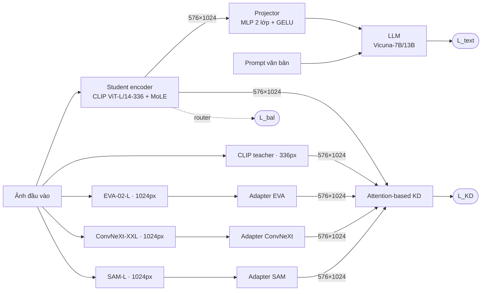

# MoVE-KD: Introduction & Methodology (Part 1)

> **Phạm vi tài liệu** (Thành viên 1 – Kiến trúc mô hình & MoLE)
> 1. **Introduction**: bối cảnh và động lực của MoVE-KD.
> 2. **Methodology – Part 1**: Overview pipeline (Sec 3.1), Encoder Adapters và Mixture-of-LoRA-Experts (Sec 3.2).
>
> Chiến lược chưng cất dựa trên attention (Sec 3.3) chỉ được nhắc ở mức tổng quan, chi tiết nằm trong Methodology – Part 2.
> Các công thức và số liệu kiến trúc trong tài liệu này được đối chiếu trực tiếp với mã nguồn trong repo (xem [mục 2.4](#24-ánh-xạ-sang-mã-nguồn)).

---

## 1. Introduction

### 1.1 Bối cảnh

**Vision encoder quyết định "LLM nhìn thấy gì".** Các Vision-Language Model (VLM) hiện đại như LLaVA-1.5 có kiến trúc ba khối: *vision encoder* → *projector* → *large language model (LLM)*. Vision encoder biến ảnh thành chuỗi visual token, projector ánh xạ chúng sang không gian embedding của LLM, và LLM sinh câu trả lời. Mọi thông tin thị giác mà LLM nhận được đều phải đi qua vision encoder, nên chất lượng của encoder giới hạn trực tiếp năng lực của cả hệ thống.

**CLIP mạnh nhưng không toàn diện.** Encoder phổ biến nhất là CLIP ViT-L/14-336, được huấn luyện bằng học tương phản ảnh–văn bản. CLIP có khả năng căn chỉnh ngữ nghĩa với ngôn ngữ rất tốt, nhưng vì chỉ học biểu diễn toàn cục ở độ phân giải 336×336 nên còn yếu ở các chi tiết nhỏ, định vị đối tượng, đọc chữ trong ảnh và các tác vụ cần thông tin ở mức pixel.

**Mỗi vision foundation model có một "sở trường" riêng**, tuỳ theo dữ liệu và mục tiêu tiền huấn luyện:

| Encoder | Tiền huấn luyện | Sở trường | Vai trò trong MoVE-KD |
| :--- | :--- | :--- | :--- |
| **CLIP ViT-L/14-336** | Tương phản ảnh–văn bản | Ngữ nghĩa toàn cục, căn chỉnh với ngôn ngữ | Khởi tạo student + teacher "neo" |
| **EVA-02-L** | MIM + fine-tune phát hiện đối tượng (COCO/O365) | Định vị, nhận dạng đối tượng | Teacher (v1.0, v1.1) |
| **ConvNeXt-XXLarge** | CLIP trên LAION-2B | Đặc trưng độ phân giải cao, inductive bias của CNN | Teacher (v1.0, v1.1) |
| **SAM ViT-L** | Phân đoạn (SA-1B) | Biên, hình dạng, chi tiết mức pixel | Teacher (v1.1) |
| Pix2Struct-L | Parse ảnh chụp màn hình → HTML | Tài liệu, OCR | Được hỗ trợ trong code, không dùng ở v1.0/v1.1 |

**Xu hướng dùng nhiều encoder và cái giá phải trả.** Để tận dụng các sở trường này, nhiều VLM gần đây (Eagle, Cambrian-1, Mini-Gemini, SPHINX, …) ghép nhiều encoder vào cùng một mô hình rồi trộn đặc trưng của chúng. Cách làm này cải thiện kết quả rõ rệt, nhưng chi phí tăng gần như tuyến tính theo số encoder: mỗi ảnh phải đi qua *tất cả* encoder, thường ở độ phân giải cao. Ví dụ, bộ teacher của MoVE-KD v1.1 (CLIP-L + EVA-02-L + ConvNeXt-XXL + SAM-L) có tổng cộng khoảng **1,76 tỉ tham số**, gấp gần 6 lần một CLIP-L (≈ 0,30 tỉ). Ba trong bốn encoder còn chạy ở 1024×1024. Hệ quả là độ trễ suy luận, bộ nhớ GPU và chi phí triển khai đều tăng mạnh.

### 1.2 Động lực

MoVE-KD (*Mixture-of-Visual-Encoder Knowledge Distillation*, CVPR 2025) đặt câu hỏi:

> *Có thể giữ được sở trường của nhiều vision encoder mà khi suy luận chỉ cần chạy **một** encoder hay không?*

Câu trả lời tự nhiên là **chưng cất tri thức (knowledge distillation) từ nhiều teacher vào một student**. Tuy nhiên, cách làm ngây thơ (một student với bộ trọng số dùng chung, hồi quy đồng thời đặc trưng của mọi teacher) gặp bốn vấn đề:

1. **Bất đồng không gian đặc trưng.** Các teacher khác nhau về độ phân giải đầu vào, số token và số chiều kênh: CLIP cho 576×1024, EVA-02 cho 4096×1024, ConvNeXt cho 1024×3072, SAM cho 4096×256. Không thể tính loss trực tiếp giữa student và teacher.
2. **Xung đột tri thức (knowledge conflict).** Đặc trưng ngữ nghĩa của CLIP, đặc trưng hình học của SAM và đặc trưng định vị của EVA-02 thường "kéo" trọng số theo các hướng khác nhau. Khi một bộ trọng số dùng chung phải bắt chước tất cả, gradient từ các teacher triệt tiêu lẫn nhau. Student rốt cuộc chỉ học được một dạng "trung bình" và đánh mất sở trường riêng của từng teacher.
3. **Quên thảm hoạ (catastrophic forgetting).** Student được khởi tạo từ CLIP, và projector cùng LLM phụ thuộc vào không gian đặc trưng đã căn chỉnh với ngôn ngữ của CLIP. Nếu cập nhật toàn bộ trọng số encoder để bắt chước các teacher khác, tri thức căn chỉnh ảnh–văn bản quý giá này sẽ bị ghi đè.
4. **Không phải token nào, teacher nào cũng quan trọng như nhau.** Chưng cất đồng đều trên mọi token (kể cả token nền) và mọi teacher (với mọi ảnh) làm lãng phí năng lực của student.

MoVE-KD giải quyết từng vấn đề bằng một thành phần riêng:

| Vấn đề | Giải pháp trong MoVE-KD | Mục |
| :--- | :--- | :--- |
| (1) Bất đồng không gian đặc trưng | **Encoder Adapters**: chiếu đặc trưng mỗi teacher về đúng kích thước 576×1024 của student | 2.2 |
| (2) Xung đột tri thức | **Mixture-of-LoRA-Experts (MoLE)**: router chọn expert theo từng token, mỗi expert có thể chuyên về một loại tri thức | 2.3 |
| (3) Quên thảm hoạ | **MoLE** giữ nguyên trọng số gốc của CLIP (đóng băng ở Stage 1), chỉ học phần bù low-rank; teacher CLIP giữ trọng số cố định 0,8 trong KD loss | 2.3 |
| (4) Token/teacher không đồng giá trị | **Attention-based KD**: trọng số token theo attention của CLS, trọng số teacher theo độ tương đồng với CLS | Part 2 (3.3) |

#### Vì sao dùng LoRA thay vì nhân bản FFN?

Cách làm MoE kinh điển là nhân bản khối FFN thành nhiều expert. Với student CLIP ViT-L (24 layer, `d = 1024`, `d_ff = 4096`), so sánh như sau (tính từ cấu hình trong `scripts/move-kd/*.sh`: 3 expert, rank 32):

| | MoE nhân bản FFN (3 expert) | **MoLE (3 LoRA expert, r = 32)** |
| :--- | ---: | ---: |
| Tham số expert mỗi layer | ≈ 25,2 M | **≈ 1,0 M** |
| Tổng tham số expert (24 layer) | ≈ 604 M | **≈ 24,0 M** (ít hơn ≈ 25 lần) |
| So với CLIP ViT-L (≈ 304 M) | ≈ 199 % (encoder to ≈ 2,3 lần) | **≈ 7,9 %** |
| So với toàn bộ VLM 7B (≈ 7,06 B) | ≈ 8,6 % | **≈ 0,34 %** |
| Trạng thái optimizer Adam mixed-precision (~16 B/tham số) | ≈ 9,7 GB | **≈ 0,38 GB** |
| FLOPs thêm/token/layer khi suy luận (top-1) | 0 (nhưng encoder nặng hơn rất nhiều) | **≈ 3,9 % FLOPs của FFN** |

Ngoài lợi thế về tham số và bộ nhớ GPU, LoRA còn có ba lợi ích quan trọng khác:

- **Tiết kiệm GPU cho teacher.** Khi huấn luyện, bốn teacher (≈ 1,76 B tham số, bf16) đã chiếm nhiều VRAM. Phần trainable của student càng nhỏ thì càng dễ đặt vừa trên GPU với ZeRO-2.
- **Chống quên thảm hoạ.** Mọi expert dùng chung trọng số FFN gốc của CLIP (được đóng băng ở Stage 1) và chỉ học *phần bù* $\Delta W = BA$. Tri thức gốc vì thế luôn được giữ nguyên.
- **Khởi đầu tốt.** Expert không phải học lại từ đầu hay sao chép nguyên một FFN, mà bắt đầu ngay từ biểu diễn đã tốt của CLIP.

### 1.3 Đóng góp và kết quả

- Đề xuất **MoVE-KD**, framework chưng cất sở trường của nhiều vision encoder vào **một** encoder duy nhất, huấn luyện cùng VLM theo quy trình hai giai đoạn của LLaVA.
- Dùng **Encoder Adapters** và **MoLE** để thống nhất không gian đặc trưng và giảm xung đột tri thức giữa các teacher. MoLE chỉ thêm khoảng 0,3 % tham số so với VLM 7B, còn adapter chỉ dùng khi huấn luyện.
- Đề xuất **chưng cất dựa trên attention**, tự động đánh trọng số theo teacher và theo token.
- Trên LLaVA-1.5, MoVE-KD vượt baseline ở hầu hết benchmark mà chi phí suy luận vẫn gần như của một CLIP encoder:

| Method | LLM | VQAv2 | GQA | TextVQA | VizWiz | POPE | SQA | MME | MMB |
| :---: | :---: | :---: | :---: | :---: | :---: | :---: | :---: | :---: | :---: |
| LLaVA-v1.5 | Vicuna-7B | 78.5 | 62.0 | 58.2 | 50.0 | 85.9 | 66.8 | 1510.7 | 64.3 |
| MoVE-KD-v1.0 | Vicuna-7B | 79.5 | 63.2 | 58.3 | 52.3 | 86.9 | 69.3 | 1524.5 | 66.3 |
| MoVE-KD-v1.1 | Vicuna-7B | 79.9 | 63.9 | 59.6 | 52.7 | 86.3 | 69.8 | 1509.1 | 67.4 |
| LLaVA-v1.5 | Vicuna-13B | 80.0 | 63.3 | 61.3 | 53.6 | 85.9 | 71.6 | 1531.3 | 67.7 |
| MoVE-KD-v1.0 | Vicuna-13B | 80.6 | 64.2 | 59.7 | 55.7 | 85.7 | 73.2 | 1568.1 | 70.2 |
| MoVE-KD-v1.1 | Vicuna-13B | 80.8 | 63.9 | 61.1 | 57.5 | 86.3 | 71.8 | 1568.3 | 69.7 |

*(v1.0: teacher = CLIP + EVA-02 + ConvNeXt; v1.1: thêm SAM.)*

---

## 2. Methodology – Part 1

### 2.1 Overview pipeline (Sec 3.1)

**Ký hiệu.** Ảnh đầu vào $I$; tập $K$ teacher $\{\mathcal{T}_k\}_{k=1}^{K}$ (đều đóng băng); student $\mathcal{S}$; projector $\mathcal{P}$; LLM $\mathcal{L}$.

**Luồng xử lý trong một bước huấn luyện:**

1. **Student.** $I$ được tiền xử lý về 336×336 rồi đưa qua student, tức CLIP ViT-L/14-336 trong đó mọi FFN đã được thay bằng khối MoLE. Lấy hidden state ở layer áp chót (`mm_vision_select_layer = -2`) và bỏ token CLS, ta được $F_s \in \mathbb{R}^{N \times D}$ với $N = 576$ (lưới 24×24), $D = 1024$.
2. **Nhánh ngôn ngữ.** $F_s$ đi qua projector $\mathcal{P}$ (MLP 2 lớp, GELU) thành visual token cho LLM. LLM nhận visual token cùng prompt và tính loss sinh văn bản $\mathcal{L}_{\text{text}}$ (next-token prediction).
3. **Nhánh teacher.** Cùng ảnh $I$ được tiền xử lý theo đúng chuẩn của từng teacher (CLIP ở 336px; EVA-02, ConvNeXt, SAM ở 1024px) và đưa qua teacher trong chế độ `torch.no_grad()`, cho ra $F_k \in \mathbb{R}^{N_k \times D_k}$.
4. **Encoder Adapters.** Mỗi $F_k$ (trừ CLIP, vốn đã có kích thước 576×1024) được chiếu về $\hat{F}_k \in \mathbb{R}^{N \times D}$ (mục 2.2).
5. **Chưng cất.** Tính MSE giữa $F_s$ và từng $\hat{F}_k$, rồi gộp lại với trọng số theo token và theo teacher (Part 2), thu được $\mathcal{L}_{\text{KD}}$.
6. **Cân bằng expert.** Xác suất routing của MoLE được dùng để tính $\mathcal{L}_{\text{bal}}$ (mục 2.3).

**Hàm mục tiêu tổng:**

$$
\mathcal{L} \;=\; \mathcal{L}_{\text{text}} \;+\; \lambda_{\text{kd}}\,\mathcal{L}_{\text{KD}} \;+\; \lambda_{\text{bal}}\,\mathcal{L}_{\text{bal}},
\qquad \lambda_{\text{kd}} = 0.5,\;\; \lambda_{\text{bal}} = 0.01
$$

(`--kd_w 0.5`, `--moe_encoder_balance_w 0.01`.)

**Huấn luyện hai giai đoạn** (theo LLaVA):

| | Stage 1 – Pre-training | Stage 2 – Fine-tuning |
| :--- | :--- | :--- |
| Dữ liệu | LCS-558K (`blip_laion_cc_sbu_558k.json`) | LLaVA-1.5 mix 665K (`llava_v1_5_mix665k.json`) |
| **Được huấn luyện** | MoLE (LoRA experts + router), Encoder Adapters, Projector | Toàn bộ: LLM, projector, student encoder (gồm MoLE), adapters |
| **Đóng băng** | LLM, trọng số gốc của student CLIP, tất cả teacher | Tất cả teacher |
| Learning rate / batch mỗi GPU | 1e-3 / 16 | 2e-5 / 8 |
| Đầu ra | `mm_projector.bin`, `mole_encoder.bin`, `encoder_adapter.bin` | Checkpoint đầy đủ |

**Khi suy luận** chỉ còn *student + projector + LLM*. Teacher và encoder adapters chỉ phục vụ huấn luyện và bị loại bỏ hoàn toàn (`EvalMoVELlavaLlamaForCausalLM` không khởi tạo chúng). Chi phí suy luận vì thế chỉ bằng một CLIP-L cộng phần LoRA expert rất nhỏ.

### 2.2 Encoder Adapters (Sec 3.2)

**Vấn đề.** Đầu ra của các teacher khác nhau cả về **số token** (do khác độ phân giải và stride) lẫn **số chiều kênh**, nên không thể so trực tiếp với $F_s \in \mathbb{R}^{576 \times 1024}$.

**Thiết kế.** Mỗi teacher không phải CLIP có một adapter nhẹ gồm hai phép chiếu tuyến tính nối tiếp: chiếu **theo chiều kênh** ($D_k \to D$), qua GELU, rồi chiếu **theo chiều token** ($N_k \to N$):

$$
H_k = \mathrm{GELU}\!\left(F_k W^{\text{ch}}_k + b^{\text{ch}}_k\right) \in \mathbb{R}^{N_k \times D},
\qquad
\hat{F}_k = \left(H_k^{\top} W^{\text{tok}}_k + b^{\text{tok}}_k\right)^{\top} \in \mathbb{R}^{N \times D}
$$

với $W^{\text{ch}}_k \in \mathbb{R}^{D_k \times D}$ và $W^{\text{tok}}_k \in \mathbb{R}^{N_k \times N}$. Phép chiếu theo token là một phép **resampling không gian có học**: mỗi token đích là tổ hợp tuyến tính của mọi token nguồn, thay vì pooling cục bộ cố định.

**Kích thước cụ thể** (trích từ `initialize_teachers` và `forward` trong `move_llava_llama.py`):

| Teacher | Độ phân giải | Đặc trưng gốc $N_k \times D_k$ | Chiếu kênh | Chiếu token | Số tham số |
| :--- | :---: | :---: | :---: | :---: | ---: |
| CLIP ViT-L/14-336 | 336 | 576 × 1024 | – | – | 0 (không cần adapter) |
| EVA-02-L | 1024 | 4096 × 1024 (lưới 64×64) | 1024 → 1024 | 4096 → 576 | ≈ 3,41 M |
| ConvNeXt-XXL | 1024 | 1024 × 3072 (lưới 32×32, stage cuối) | 3072 → 1024 | 1024 → 576 | ≈ 3,74 M |
| SAM ViT-L | 1024 | 4096 × 256 (neck 256 kênh) | 256 → 1024 | 4096 → 576 | ≈ 2,62 M |
| Pix2Struct-L | 1024 | 1024 × 1536 | 1536 → 1024 | 1024 → 576 | ≈ 2,16 M |

Tổng adapter cho v1.1 (EVA + ConvNeXt + SAM) chỉ khoảng **9,8 M tham số**.

**Các lựa chọn thiết kế đáng chú ý:**

- **Chiếu teacher về student, không làm ngược lại.** Đầu ra của student giữ nguyên không gian mà projector và LLM sử dụng, và student không cần thêm "đầu" riêng cho từng teacher. Toàn bộ chi phí căn chỉnh dồn vào adapter, mà adapter thì bị bỏ khi suy luận.
- **CLIP teacher không cần adapter.** Teacher này cùng kiến trúc, cùng độ phân giải và cùng layer đặc trưng với student, nên vừa là mục tiêu chưng cất trực tiếp vừa đóng vai trò "neo" giữ tri thức gốc.
- **Adapter được huấn luyện cùng MoLE ở Stage 1** (`--tune_encoder_adapter True`), lưu vào `encoder_adapter.bin` và nạp lại ở Stage 2 (`--pretrain_encoder_adapter`).

### 2.3 Mixture-of-LoRA-Experts – MoLE (Sec 3.2)

**Vị trí.** MoLE thay thế khối **FFN (MLP)** trong **cả 24 layer** Transformer của student CLIP ViT-L. Self-attention, LayerNorm và phần còn lại giữ nguyên.

FFN gốc của CLIP ở mỗi layer:

$$
\mathrm{FFN}(x) = W_2\,\sigma(W_1 x + b_1) + b_2,\qquad W_1 \in \mathbb{R}^{4096 \times 1024},\; W_2 \in \mathbb{R}^{1024 \times 4096}
$$

($\sigma$ là quick-GELU.) Trong MoLE, $W_1, W_2$ được **đóng băng** ở Stage 1 (Stage 2 mở toàn bộ với learning rate nhỏ 2e-5), và mỗi layer có thêm:

- **$E$ LoRA expert**, mỗi expert gồm hai cặp low-rank: $\Delta^{e}_{1}$ gắn với $W_1$ (`moe_down`, 1024 → 4096) và $\Delta^{e}_{2}$ gắn với $W_2$ (`moe_up`, 4096 → 1024):

$$
\Delta^{e}_{j}(x) = \frac{\alpha}{r}\, B^{e}_{j}\, A^{e}_{j}\, \mathrm{Dropout}(x),\qquad A^{e}_{j} \in \mathbb{R}^{r \times d_{\text{in}}},\; B^{e}_{j} \in \mathbb{R}^{d_{\text{out}} \times r}
$$

- **Một router tuyến tính** cho mỗi layer, hoạt động **theo từng token** (577 token, kể cả CLS):

$$
p(x) = \mathrm{softmax}(W_r x + b_r) \in \mathbb{R}^{E},\qquad e^{*}(x) = \arg\max_{e}\, p_e(x)
$$

**Sparse MoLE (top-1, mặc định `--moe_encoder_dense False`).** Mỗi token chỉ đi qua expert được chọn, và *cùng một* expert $e^*$ được dùng cho cả hai phép chiếu của FFN:

$$
h = \sigma\!\left(W_1 x + b_1 + \Delta^{e^*}_{1}(x)\right),\qquad
\mathrm{MoLE}(x) = W_2 h + b_2 + \Delta^{e^*}_{2}(h)
$$

**Dense MoLE (`--moe_encoder_dense True`).** Mọi expert cùng đóng góp, có trọng số theo xác suất của router:

$$
h = \sigma\!\left(W_1 x + b_1 + \textstyle\sum_{e} p_e(x)\,\Delta^{e}_{1}(x)\right),\qquad
\mathrm{MoLE}(x) = W_2 h + b_2 + \textstyle\sum_{e} p_e(x)\,\Delta^{e}_{2}(h)
$$

**Loss cân bằng tải (load balancing).** Để tránh router dồn mọi token vào một expert (expert collapse), MoVE-KD dùng một biến thể của Switch-Transformer loss. Gọi $\bar{p}_e$ là xác suất routing trung bình của expert $e$ và $f_e$ là tỉ lệ token thực sự chọn expert $e$, cả hai lấy trung bình trên mọi layer và token của một ảnh $b$:

$$
\mathcal{L}_{\text{bal}} = \frac{1}{B}\sum_{b=1}^{B}\sum_{e=1}^{E} \bar{p}^{(b)}_{e}\, f^{(b)}_{e}
$$

Tổng này nhỏ nhất khi token được phân bố đều giữa các expert.

**Siêu tham số** (`scripts/move-kd/*.sh`):

| Tham số | Giá trị | Cờ dòng lệnh |
| :--- | :---: | :--- |
| Số expert $E$ | 3 | `--moe_encoder_num_experts 3` |
| LoRA rank $r$ | 32 | `--moe_encoder_lora_rank 32` |
| LoRA alpha $\alpha$ (scaling $\alpha/r = 1/32$) | 1 | `--moe_encoder_lora_alpha 1` |
| LoRA dropout | 0.05 | hardcode trong `MoE_LoRA_CLIP` |
| Routing | top-1 (sparse) | `--moe_encoder_dense False` |
| $\lambda_{\text{bal}}$ | 0.01 | `--moe_encoder_balance_w 0.01` |

**Vì sao MoLE giảm xung đột tri thức và quên thảm hoạ?**

- **Tách không gian tham số theo token.** Mỗi token chỉ cập nhật expert của nó, nên gradient từ các loại đặc trưng khác nhau (vùng cần chi tiết biên kiểu SAM, vùng đối tượng kiểu EVA-02, …) có thể rơi vào các expert khác nhau thay vì tranh chấp trên cùng một bộ trọng số.
- **Trọng số gốc được bảo toàn.** $W_1, W_2$ của CLIP bị đóng băng ở Stage 1 và mọi thay đổi chỉ nằm trong phần bù low-rank $\Delta = BA$ (scaling nhỏ $1/32$). Biểu diễn căn chỉnh ngôn ngữ của CLIP, thứ mà projector và LLM dựa vào, không bị ghi đè.
- **Có "neo" từ teacher CLIP.** Trong KD loss, teacher CLIP luôn giữ trọng số cố định $0.8$ (`--kd_memory_w 0.8`), còn $0.2$ được chia cho các teacher còn lại. Cơ chế này kéo student ở lại gần không gian của CLIP.
- **Rẻ.** Với top-1 routing, mỗi token chỉ tốn thêm khoảng 3,9 % FLOPs của FFN, và toàn bộ MoLE chỉ thêm khoảng 24 M tham số (≈ 0,34 % của VLM 7B).

### 2.4 Ánh xạ sang mã nguồn

| Thành phần | File | Lớp / hàm |
| :--- | :--- | :--- |
| LoRA layer | [`llava/model/multimodal_encoder/moe_lora.py`](llava/model/multimodal_encoder/moe_lora.py) | `LoRALayer` |
| Khối MoLE (router + experts, sparse/dense) | [`moe_lora.py`](llava/model/multimodal_encoder/moe_lora.py) | `MoE_LoRA_CLIP` |
| CLIP layer/encoder trả thêm `routings` | [`moe_lora.py`](llava/model/multimodal_encoder/moe_lora.py) | `MoECLIPEncoderLayer`, `MoECLIPEncoder`, `MoECLIPVisionTransformer` |
| Khởi tạo teacher | [`mixture_vision_models.py`](llava/model/multimodal_encoder/mixture_vision_models.py) | `init_vision_teachers` |
| Thay FFN → MoLE, tạo Encoder Adapters | [`move_llava_llama.py`](llava/model/language_model/move_llava_llama.py) | `MoVELlavaLlamaForCausalLM.initialize_teachers` |
| $\mathcal{L}_{\text{bal}}$, adapters, $\mathcal{L}_{\text{KD}}$ | [`move_llava_llama.py`](llava/model/language_model/move_llava_llama.py) | `MoVELlavaLlamaForCausalLM.forward` |
| Tham số dòng lệnh, freeze/unfreeze, lưu `mole_encoder.bin` / `encoder_adapter.bin` | [`llava/train/train.py`](llava/train/train.py) | `ModelArguments`, `TrainingArguments`, `train`, `safe_save_model_for_hf_trainer` |
| Bật Flash-Attention 2 | [`llava/train/train_mem.py`](llava/train/train_mem.py) | `train(attn_implementation="flash_attention_2")` |
| Script huấn luyện | [`scripts/move-kd/`](scripts/move-kd/) | `pretrain-v1.x.sh`, `finetune-v1.x.sh` |

**Một số ghi chú khi đọc code** (khác biệt giữa cài đặt thực tế và mô tả lý thuyết, nên lưu ý khi viết báo cáo hoặc thí nghiệm):

- **Router ở chế độ sparse chỉ học qua $\mathcal{L}_{\text{bal}}$.** Trong `forward_lora_moe_sparse`, đầu ra LoRA *không* được nhân với $p_e(x)$, còn tensor `expert_choice` (straight-through) bị `.detach()` khi tính loss. Vì vậy, ở cấu hình mặc định, router chỉ nhận gradient từ loss cân bằng chứ không từ $\mathcal{L}_{\text{text}}$ hay $\mathcal{L}_{\text{KD}}$. Chế độ dense không có hạn chế này.
- **LoRA không khởi tạo $B = 0$.** Cả `lora_A` và `lora_B` đều dùng Kaiming-uniform (có bias), khác với LoRA chuẩn. Ngay từ đầu, đầu ra MoLE đã lệch một chút so với FFN gốc; scaling $\alpha/r = 1/32$ giữ độ lệch này nhỏ.
- **Teacher không phải `nn.Module` con của mô hình.** Chúng được lưu trong một `dict` Python (`self.vision_teachers`), nên không xuất hiện trong `model.parameters()`. Do đó teacher không bao giờ được huấn luyện (kể cả với `--tune_all True`) và không bị lưu vào checkpoint.
- **Trọng số teacher phải đặt đúng đường dẫn hardcode** trong `mixture_vision_models.py`: `./checkpoints/sam/sam_vit_l` và `./checkpoints/EVA/eva02/det/eva02_L_coco_det_sys_o365.pth`. Script [`setup.sh`](setup.sh) (`DOWNLOAD_CKPT=1`) tải sẵn các file này.

---

## Tài liệu tham khảo

1. J. Cao et al. *MoVE-KD: Knowledge Distillation for VLMs with Mixture of Visual Encoders.* CVPR 2025. [arXiv:2501.01709](https://arxiv.org/abs/2501.01709)
2. H. Liu et al. *Improved Baselines with Visual Instruction Tuning (LLaVA-1.5).* CVPR 2024.
3. E. J. Hu et al. *LoRA: Low-Rank Adaptation of Large Language Models.* ICLR 2022.
4. W. Fedus, B. Zoph, N. Shazeer. *Switch Transformers: Scaling to Trillion Parameter Models with Simple and Efficient Sparsity.* JMLR 2022.
5. M. Shi et al. *Eagle: Exploring the Design Space for Multimodal LLMs with Mixture of Encoders.* 2024.
6. A. Radford et al. *Learning Transferable Visual Models from Natural Language Supervision (CLIP).* ICML 2021.
7. Y. Fang et al. *EVA-02: A Visual Representation for Neon Genesis.* 2023.
8. A. Kirillov et al. *Segment Anything.* ICCV 2023.
9. Z. Liu et al. *A ConvNet for the 2020s (ConvNeXt).* CVPR 2022.
